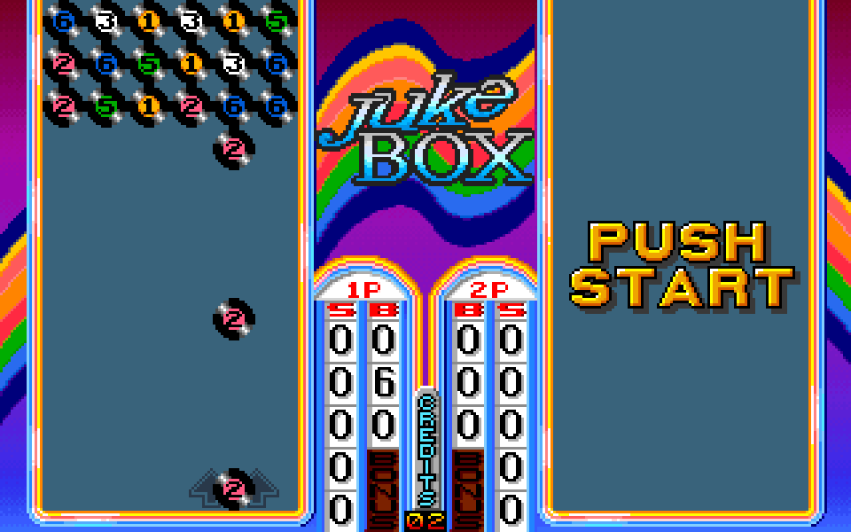

<h1 align="center">
  <br>
  scry-core
</h1>

<p align="center"><b>SCRY turns your AI client into a debugger for old machines: ask what a program in MAME or DOSBox-X is doing, and it finds out.</b></p>

<p align="center">
  <a href="https://github.com/scry-mcp/scry-dosbox-x"><picture><source media="(prefers-reduced-motion: reduce)" srcset="docs/scry-dosbox-x.png"></picture></a>
  <a href="https://github.com/scry-mcp/scry-mame"><picture><source media="(prefers-reduced-motion: reduce)" srcset="docs/scry-mame.png"></picture></a>
</p>
<p align="center"><em>scry-dosbox-x rewrites a line of Monkey Island while the game runs; scry-mame plays LineUp on its arcade board, one call a shot.</em></p>

SCRY is two [MCP](https://modelcontextprotocol.io) servers, one per emulator. Each keeps its
emulator open at the debugger, so your client can stop the program, read its memory by name
and press its inputs, and each reply carries its evidence. This repository is the Python
package both are built on: it comes with the server you install, never on its own.

## Install a server

- [scry-mame](https://github.com/scry-mcp/scry-mame#install), for an arcade board or a home
  computer running in MAME. It needs a MAME built with its gdbstub and its `console` plugin.
- [scry-dosbox-x](https://github.com/scry-mcp/scry-dosbox-x#install), for a DOS program running
  in DOSBox-X. It needs a DOSBox-X built with its debugger.

Both need git and [uv](https://docs.astral.sh/uv/), on macOS or Windows. Each server's README
has the lines to paste for your MCP client, and a first question to ask.

The rest of this page is for somebody writing or changing a server.

## What the package holds

Whatever both servers need is written here once. Before writing a helper in a server, look for
it in [docs/modules.md](docs/modules.md), which has one row per module.

| Group | What it holds |
|---|---|
| [Replies](docs/modules.md#replies) | the fields every reply carries, a refusal, and each tool's reply schema |
| [Calls](docs/modules.md#calls) | the wrapper every tool call goes through, cancelling, progress, argument checks |
| [Running and stopping](docs/modules.md#running-and-stopping) | waits on a log, on the screen and on a frame |
| [Several calls as one](docs/modules.md#several-calls-as-one) | lists of steps (`perform`), a session exported and replayed |
| [Breakpoints, watches and comments](docs/modules.md#breakpoints-watches-and-comments) | the files they are saved in, and how a watched value is typed |
| [The `.scry/` folder](docs/modules.md#the-scry-folder) | what a repository keeps for its own program, and `promote`, which writes it |
| [Pictures, video and sound](docs/modules.md#pictures-video-and-sound) | PNG, AVI and WAV read and compared, screen maps |
| [Windows and processes](docs/modules.md#windows-and-processes) | where an emulator's window opens, and what ends it with its server |
| [Files](docs/modules.md#files) | the one rule for a file's name, and files never written over another |
| [What generates the documents](docs/modules.md#what-generates-the-documents) | the reference pages, the demo pages, the install block |
| [Tests a server runs](docs/modules.md#tests-a-server-runs) | shared test classes, pytest plugins, the pre-commit check |
| [Tests against a real emulator](docs/modules.md#tests-against-a-real-emulator) | what a test script records, and the check that a run took nobody's focus |

## How a server uses it

A server pins a release tag, never a branch:

```toml
dependencies = ["scry-core @ git+https://github.com/scry-mcp/scry-core@<tag>"]
```

These programs run from a server's repository:

```sh
uv run python -m scry_core.reference <module>:<attribute> [--write]
uv run python -m scry_core.install <package> [--write]
uv run python -m scry_core.probe all --check --servers mcp_probe/servers.py --tasks mcp_probe/tasks
uv run python -m scry_core.traffic <server> --servers mcp_probe/servers.py --transcript <jsonl>
uv run python -m scry_core.live_bench check --bench <folder>
uv run python -m scry_core.replay <document> [--binary PATH] [--rompath DIR]
uv run python -m scry_core.scry_readme [--check] [DIR]
uv run python -m scry_core.window_cli displays
uv run python -m scry_core.hook
```

`--help` on each says what it takes and what it exits with. `window_cli` keeps that in its
module docstring instead: `uv run python -m pydoc scry_core.window_cli`.

- `reference` writes a server's reference pages from its tools, and `install` the block of its
  README that adds it to each MCP client.
- `probe` is the description test: it gives a model only what the client delivers and checks
  the calls it makes. A real run asks the `claude` CLI; `--check` needs no network.
- `live_bench` checks the folder of test programs the tests against a real emulator run on.
- `hook` is the pre-commit check. It needs `jscpd` on the `PATH` and a tracked
  `.jscpd-baseline.json`, and each server's `.githooks/pre-commit.sh` is the one line that
  calls it.

`reply_shapes` is a pytest plugin that arrives with this package. A suite names the modules it
wraps in its own configuration, and a run that names none is refused:

```toml
[tool.pytest.ini_options]
reply_shapes_anchors = ["scry_core.reply_contract", "scry_core.boundary"]
```

Each server keeps its demos in `demos/<name>/`, run by `scry_core.demo`. A `demo.py` makes the
calls its README asks an MCP client to make and checks every answer. With `--update-readme` it
writes the README's examples, `TRANSCRIPT.md`, `screen.png` and `loop.webp` from that run.

A demo with a `Lead` also writes what its server's README opens with: its clip, a caption and
one step of the run as an exchange.

A game that exists for both emulators has one script, with the same symbols, screen map and
checks on both. Each server runs it with a short `Binding` (`scry_core.game_demo`), the object
that holds what its emulator does differently.
[The list of demos](docs/katas.md) says which server runs each, and
[docs/new-emulator.md](docs/new-emulator.md) is the checklist for a third server.

## Trying a server by hand

[MCP Inspector](https://github.com/modelcontextprotocol/inspector) calls a server directly and
shows each raw request and reply. It starts its own copy of the server, so it cannot see a
session another client holds. Save this as `inspector.json`:

```json
{
  "mcpServers": {
    "Scry - MAME MCP": {
      "type": "stdio",
      "command": "uv",
      "args": ["run", "--directory", "/path/to/scry-mame", "scry-mame"],
      "env": {"MAME_BINARY": "/path/to/mame"}
    }
  }
}
```

`MAME_BINARY` is optional: without it `start` takes `mame` from the `PATH`. Add scry-dosbox-x
the same way, under its own name, with its own directory and command.

Run this beside the file and open the URL it prints, token included. `HOST` keeps the page on
your own machine:

```sh
HOST=127.0.0.1 npx -y @modelcontextprotocol/inspector@2.11.0 --web --config inspector.json
```

Use the web page for anything that spans calls: `--cli` starts a fresh server per call, so the
emulator a `start` opened ends with it. `--cli` exits 0 on a refusal, because an `INVALID`
reply is a result: read its `status`.

## Developing

```sh
uv sync
uv run ruff check .
uv run mypy --strict .
uv run mypy --strict --platform win32 .
uv run pytest -q
```

On Windows the last one is `uv run pytest -q --no-cov`. The coverage floor is checked on macOS,
because Windows skips the cases that need what it lacks (a FIFO, a mode bit).

Each repository looks for duplicated code in itself only. So before writing a formatter, a
parser or a reply helper in one server, search this package and the other server for it. What
both servers need lives here from the second server on.

When a change touched both servers, run `jscpd` over the three repositories together and read
its JSON beside the diff. It refuses nothing there: a clone across repositories is something to
fix, like a helper with one caller or a parameter nobody passes.

## Opt-in tests

The tests that open windows and move a Space take your screen and keyboard, so a plain
`pytest` leaves them out. Run them by their marker, when nobody else is using the machine:

```sh
SCRY_FOCUS_CONTROL=1 uv run pytest -m window --no-cov   # macOS
uv run pytest -m window --no-cov                        # Windows, on an interactive desktop
```

A server gets the marker and its fixture with this package, and adds only `not window` to its
own `addopts`. [docs/live-tests.md](docs/live-tests.md) says what these tests open, how a run
shows it took nobody's focus, and how independent jobs run in parallel.

## Platforms

macOS and Windows. Every module imports on both, and what only one of them has is chosen by
`sys.platform`.

Licence: MIT.

## Credits

Developed by Optimiza ([Marcos Hernández](https://www.linkedin.com/in/optimiza/)), in collaboration with [MS-DOS Club](https://msdos.club) and its [podcast](https://www.ivoox.com/podcast-ms-dos-club_sq_f11160693_1.html).
